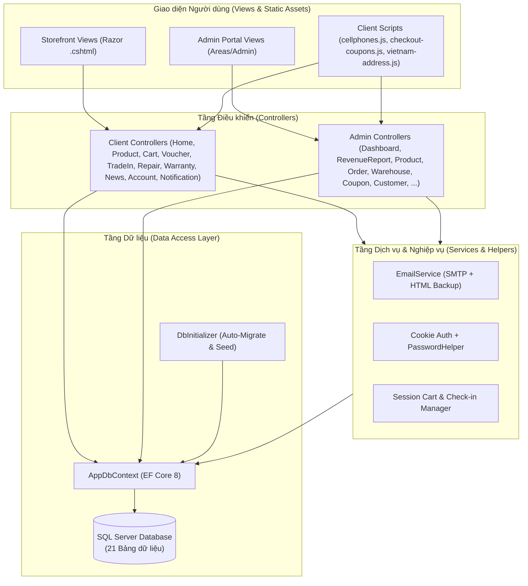
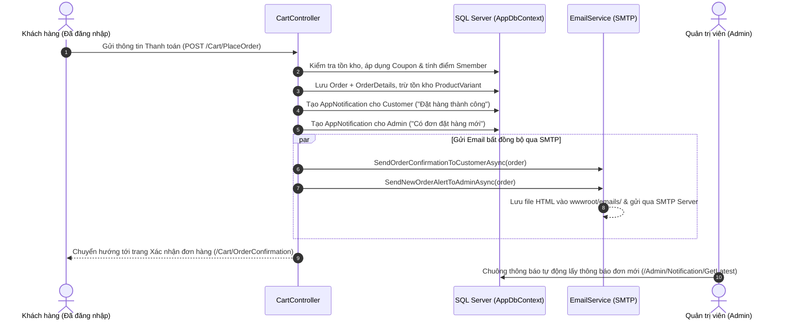

# 📱 Website Bán Điện Thoại & Hệ Sinh Thái Bán Lẻ Công Nghệ (CellphoneS Clone)

Hệ thống thương mại điện tử và quản trị bán lẻ thiết bị công nghệ toàn diện được xây dựng trên nền tảng **ASP.NET Core 8.0 MVC** và **Entity Framework Core (SQL Server)**, lấy cảm hứng từ hệ sinh thái **CellphoneS — Điện Thoại Vui — Sforum**.

Dự án tích hợp trọn vẹn quy trình từ trải nghiệm mua sắm đa biến thể của khách hàng, điểm danh nhận Voucher hàng ngày, thu cũ đổi mới (Trade-In), đặt lịch sửa chữa, tra cứu bảo hành điện tử, thông báo thời gian thực (In-App Notification) kết hợp gửi Email tự động qua giao thức **SMTP**, cho đến hệ thống quản trị kho hàng, đơn hàng và báo cáo doanh thu chuyên sâu dành cho Admin.

---

## 🌟 Điểm Nổi Bật Của Dự Án

- **Giao diện đồng bộ chuẩn CellphoneS (`#d70018`)**: Thiết kế hiện đại, hỗ trợ Responsive trên mọi thiết bị, hiệu ứng mượt mà, đồng bộ màu sắc và bố cục từ Trang chủ, Trang danh mục, Chi tiết sản phẩm đến Quản trị viên.
- **Sản phẩm đa biến thể (Multi-Variant Products)**: Mỗi sản phẩm hỗ trợ nhiều tùy chọn **Dung lượng (Storage)** và **Màu sắc (Color)** với giá bán, mã SKU, số lượng tồn kho và **hình ảnh thực tế riêng biệt cho từng biến thể** (đã đồng bộ 19 dòng sản phẩm chủ lực cùng 77+ ảnh biến thể chuẩn CDN CellphoneS).
- **Điểm danh nhận Voucher hàng ngày (`/Voucher`)**: Bắt buộc đăng nhập để điểm danh theo chuỗi 7 ngày, tự động cấp mã giảm giá độc quyền theo ngày kèm kho sưu tầm Coupon theo cấp bậc thành viên Smember.
- **Thanh toán bảo mật & Địa chỉ hành chính 3 cấp**: Yêu cầu đăng nhập (`[Authorize]`) khi thanh toán, tích hợp dữ liệu Tỉnh/Thành phố — Quận/Huyện — Phường/Xã Việt Nam, áp dụng mã Coupon trực tiếp và tự động tính điểm thưởng **Smember**.
- **Thông báo Kép (In-App Notification + SMTP Email)**:
  - Khi khách đặt hàng thành công hoặc khi Admin cập nhật trạng thái đơn hàng, hệ thống tự động tạo thông báo hiển thị ngay trên **Chuông thông báo** của cả Admin và Khách hàng (cập nhật thời gian thực qua AJAX polling).
  - Đồng thời gửi **Email HTML** chi tiết đơn hàng tới khách hàng và thông báo đơn mới tới Admin thông qua **SMTP (`System.Net.Mail`)**, kèm cơ chế tự động lưu bản sao HTML tại `wwwroot/emails/` để dễ dàng kiểm thử khi chưa cấu hình mật khẩu ứng dụng Gmail.
- **Hệ sinh thái dịch vụ hậu mãi khép kín**:
  - **Thu cũ đổi mới (Trade-In)**: Định giá máy cũ tự động theo 4 mức tình trạng (Loại 1 đến Loại 4), hỗ trợ trợ giá lên đời máy mới.
  - **Đặt lịch sửa chữa (Điện Thoại Vui)**: Đặt lịch hẹn sửa chữa trực tuyến theo chi nhánh và khung giờ, tra cứu tiến độ sửa chữa theo mã phiếu.
  - **Bảo hành điện tử & Tra cứu hóa đơn VAT**: Tra cứu hạn bảo hành theo số **IMEI / Serial** hoặc số điện thoại, xuất giấy chứng nhận bảo hành điện tử.
  - **Tin công nghệ Sforum**: Hiển thị tin tức công nghệ, bài đánh giá, so sánh sản phẩm lấy trực tiếp từ cơ sở dữ liệu SQL Server.
- **Tự động khởi tạo & Seed dữ liệu thông minh (`DbInitializer`)**: Tự động chạy Migration, kiểm tra cấu trúc bảng và khởi tạo đầy đủ dữ liệu mẫu (Danh mục, Thương hiệu, Sản phẩm, Biến thể, Đơn hàng, Kho hàng, Tin tức Sforum, Voucher, Tài khoản Admin/Khách hàng) ngay lần chạy đầu tiên.

---

## 🛠️ Công Nghệ Sử Dụng

| Thành phần | Công nghệ / Thư viện |
| :--- | :--- |
| **Framework Backend** | ASP.NET Core 8.0 MVC (`net8.0`) |
| **Ngôn ngữ lập trình** | C# 12, HTML5, CSS3, JavaScript (ES6+) |
| **Cơ sở dữ liệu & ORM** | Microsoft SQL Server / SQL Server LocalDB, Entity Framework Core 8.0.11 |
| **Xác thực & Phân quyền** | ASP.NET Core Cookie Authentication (`CellphoneS_Auth`), Role-based Authorization (`Admin`, `Customer`), Mã hóa mật khẩu SHA-256 (`PasswordHelper`) |
| **Quản lý trạng thái** | ASP.NET Core Distributed Memory Cache & Session (lưu giỏ hàng, lịch sử điểm danh) |
| **Dịch vụ Email** | `System.Net.Mail.SmtpClient` (`IEmailService` / `EmailService`) hỗ trợ TLS/SSL + HTML Email Template |
| **Giao diện Frontend** | Bootstrap 5, Bootstrap Icons, Google Fonts (Inter / Roboto), Custom CSS (`cellphones.css`, `site.css`) |
| **Tiện ích mở rộng** | Trợ lý ảo AI Chat Widget (`_ChatWidget.cshtml`), Bộ chọn địa chỉ Việt Nam (`vietnam-address.js`), In báo cáo PDF/Print (`ExportPdf.cshtml`) |

---

## 🏗️ Kiến Trúc Hệ Thống & Luồng Nghiệp Vụ

### 1. Kiến trúc tổng thể (Layered MVC Architecture)



### 2. Luồng Đặt hàng, Thông báo & Gửi Email tự động



---

## 🧩 Chi Tiết Các Phân Hệ Chức Năng

### A. Phân Hệ Khách Hàng (Client Storefront)

#### 1. Trang chủ & Khám phá sản phẩm (`HomeController`, `ProductController`)
- **Banner & Hero Slider**: Hiển thị các chiến dịch khuyến mãi lớn theo vị trí (`HeroSlider`, `RightBanner`, `PromoBanner`).
- **Hot Sale Cuối Tuần (Flash Sale)**: Đếm ngược thời gian thực, hiển thị phần trăm giảm giá và nhãn trả góp `Trả góp 0%`.
- **Bộ lọc & Tìm kiếm đa tiêu chí**: Lọc theo danh mục (`Điện thoại`, `Laptop`, `Máy tính bảng`, `Âm thanh`, `Đồng hồ`, `Phụ kiện`), thương hiệu (`Apple`, `Samsung`, `Xiaomi`, `OPPO`, ...), khoảng giá và sắp xếp theo giá/mới nhất.
- **Trang Chi tiết sản phẩm (`/Product/Details/{id}`)**:
  - Chuyển đổi linh hoạt giữa các **Dung lượng** (`128GB`, `256GB`, `512GB`, `1TB`) và **Màu sắc**; tự động cập nhật giá bán, trạng thái tồn kho và **ảnh sản phẩm tương ứng với từng màu**.
  - Hiển thị bảng thông số kỹ thuật chi tiết, đặc điểm nổi bật, chính sách bảo hành và ưu đãi thu cũ đổi mới.
  - Hệ thống **Đánh giá & Nhận xét thực tế**: Cho phép khách hàng chấm điểm 1–5 sao, lọc bình luận theo số sao, bấm "Hữu ích" và xem phản hồi chính thức từ Quản trị viên.

#### 2. Giỏ hàng, Thanh toán & Tích điểm Smember (`CartController`)
- **Quản lý giỏ hàng (`/Cart`)**: Thêm sản phẩm kèm biến thể cụ thể, tăng/giảm số lượng, xóa từng món hoặc làm trống giỏ hàng bằng AJAX.
- **Thanh toán bắt buộc đăng nhập (`/Cart/Checkout`)**:
  - Yêu cầu tài khoản đã đăng nhập (`[Authorize]`), tự động điền sẵn Họ tên, Số điện thoại, Email và Địa chỉ từ hồ sơ Smember.
  - Chọn hoặc nhập **Mã giảm giá (Coupon)** trực tiếp trên trang thanh toán; tự động kiểm tra điều kiện đơn tối thiểu, thời hạn và số lượt sử dụng.
  - Hỗ trợ nhiều phương thức thanh toán: Thanh toán khi nhận hàng (`COD`), Chuyển khoản ngân hàng QR (`BankTransfer`), Ví MoMo (`MoMo`), VNPay (`VNPay`).
  - Tự động cộng điểm tích lũy **Smember** và nâng hạng thành viên (`S-New` → `S-Mem` → `S-VIP`) sau khi đặt hàng.
- **Tra cứu vận đơn (`/Cart/Tracking`)**: Theo dõi tiến trình xử lý đơn hàng bằng Mã đơn hàng (`CPS...`) và Số điện thoại.

#### 3. Điểm danh nhận Voucher miễn phí hàng ngày (`VoucherController`)
- **Điểm danh 7 ngày (`/Voucher`)**:
  - Yêu cầu khách hàng đăng nhập mới được điểm danh (`POST /Voucher/ClaimDaily`).
  - Mỗi ngày điểm danh nhận ngay mã Voucher giảm giá ngẫu nhiên hoặc theo mốc thưởng chuỗi ngày liên tiếp (Ngày 1 đến Ngày 7).
- **Kho Voucher & Ưu đãi Smember**: Sưu tầm mã giảm giá đang hoạt động, sao chép nhanh mã chỉ với 1 cú nhấp chuột để áp dụng ngay ở bước thanh toán.

#### 4. Hệ thống Thông báo Thời gian thực & Email SMTP (`NotificationController`, `EmailService`)
- **Chuông thông báo trên thanh Header**:
  - Hiển thị số lượng thông báo chưa đọc (badge đỏ) cho cả Khách hàng và Admin.
  - Tự động làm mới mỗi 15 giây, cho phép đánh dấu đã đọc từng thông báo hoặc đọc tất cả.
- **Dịch vụ Email SMTP (`Services/EmailService.cs`)**:
  - Gửi email xác nhận đơn hàng thiết kế chuẩn HTML (bảng kê chi tiết sản phẩm, biến thể, tổng tiền, địa chỉ giao hàng) tới hộp thư của khách hàng.
  - Gửi email cảnh báo có đơn đặt hàng mới kèm đường dẫn xử lý nhanh cho Admin.

#### 5. Thu cũ đổi mới — Trade-In (`TradeInController`)
- **Định giá máy cũ trực tuyến (`/TradeIn`)**: Chọn hãng, dòng máy, dung lượng và tình trạng máy (4 mức phân loại tình trạng ngoại quan & chức năng) để nhận mức giá thu mua dự kiến ngay lập tức.
- **Đăng ký thu cũ lên đời**: Chọn sản phẩm muốn lên đời, hệ thống tự động tính khoản chênh lệch cần bù thêm và tạo mã hồ sơ thu cũ (`TI-...`).
- **Tra cứu hồ sơ thu cũ (`/TradeIn/Tracking`)**: Kiểm tra trạng thái thẩm định và duyệt giá từ cửa hàng.

#### 6. Đặt lịch sửa chữa — Điện Thoại Vui (`RepairController`)
- **Đặt lịch sửa chữa (`/Repair/Booking`)**: Hỗ trợ đặt lịch thay pin, ép kính, thay màn hình, sửa phần cứng theo dòng máy, chọn chi nhánh cửa hàng và ngày giờ hẹn.
- **Tra cứu phiếu sửa chữa (`/Repair/Tracking`)**: Theo dõi trạng thái sửa chữa (`Pending`, `Confirmed`, `Diagnosing`, `Repairing`, `Completed`, `Cancelled`), chi phí dự kiến và ghi chú của kỹ thuật viên.

#### 7. Bảo hành điện tử & Trang Chính sách (`WarrantyController`, `PolicyController`)
- **Tra cứu bảo hành (`/Warranty/Lookup`)**: Tra cứu theo số **IMEI / Serial Number** hoặc **Số điện thoại mua hàng**.
- **Chứng nhận bảo hành điện tử (`/Warranty/Certificate/{id}`)**: Hiển thị phiếu bảo hành điện tử chính hãng có thể in hoặc lưu PDF.
- **Hệ thống trang chính sách (`/Policy/...`)**: Chính sách bảo hành, Chính sách giao hàng, Chính sách bảo mật, Hướng dẫn mua trả góp 0%, Hướng dẫn thanh toán và Tra cứu hóa đơn điện tử VAT.

#### 8. Chuyên trang Tin công nghệ Sforum (`NewsController`)
- **Trang chủ & Chuyên trang Sforum (`/News`)**: Hiển thị toàn bộ bài viết công nghệ lưu trữ trong bảng `NewsArticles` của SQL Server.
- Hỗ trợ lọc bài viết theo chuyên mục (`Đánh giá`, `So sánh`, `Trên tay`, `Tư vấn`, `Thủ thuật`, `Khuyến mãi`), tìm kiếm từ khóa, thống kê lượt đọc và xem bài viết liên quan.

---

### B. Phân Hệ Quản Trị Viên (Admin Portal — `/Admin`)

Truy cập tại `/Admin/Dashboard` (yêu cầu tài khoản có quyền `Role = "Admin"`):

| Phân hệ Admin | Đường dẫn | Chức năng chính |
| :--- | :--- | :--- |
| **Tổng quan hệ thống** | `/Admin/Dashboard` | Thống kê tổng doanh thu, số đơn hàng, khách hàng, sản phẩm; biểu đồ doanh thu; danh sách đơn hàng mới nhất và cảnh báo sản phẩm sắp hết hàng. |
| **Báo cáo doanh thu** | `/Admin/RevenueReport` | Phân tích doanh thu theo khoảng thời gian, tỷ lệ trạng thái đơn hàng, doanh thu theo danh mục, Top sản phẩm bán chạy và **Xuất báo cáo PDF** (`/Admin/RevenueReport/ExportPdf`). |
| **Quản lý sản phẩm & Biến thể** | `/Admin/Product` | Thêm/Sửa/Xóa sản phẩm, cấu hình thông số kỹ thuật, quản lý danh sách biến thể Màu sắc — Dung lượng — Giá — Tồn kho — Ảnh riêng từng biến thể (`/Admin/Product/Variants/{id}`). |
| **Quản lý đơn hàng** | `/Admin/Order` | Xem chi tiết đơn hàng, lọc theo trạng thái, cập nhật trạng thái đơn (`Chờ xử lý` → `Đã xác nhận` → `Đang giao hàng` → `Hoàn thành` / `Đã hủy`) kèm gửi thông báo tự động cho khách hàng. |
| **Quản lý kho & Nhập hàng** | `/Admin/Warehouse` | Tạo phiếu nhập kho mới (`WarehouseReceipt`), tự động cộng dồn số lượng tồn kho cho từng biến thể sản phẩm và lưu vết lịch sử biến động kho (`InventoryLog`). |
| **Quản lý Voucher / Coupon** | `/Admin/Coupon` | Tạo mã giảm giá theo phần trăm hoặc số tiền cố định, thiết lập hạn mức giảm tối đa, giá trị đơn tối thiểu, số lượt sử dụng và ngày hết hạn. |
| **Quản lý Thu cũ đổi mới** | `/Admin/TradeIn` | Tiếp nhận yêu cầu thu cũ của khách, cập nhật mức giá thu mua thực tế sau kiểm định và chuyển trạng thái hồ sơ. |
| **Quản lý Sửa chữa** | `/Admin/Repair` | Quản lý lịch hẹn sửa chữa, phân công kỹ thuật viên, cập nhật chi phí thực tế và tiến độ sửa chữa. |
| **Quản lý Bảo hành** | `/Admin/Warranty` | Cấp mới thẻ bảo hành điện tử theo IMEI/Serial, cập nhật thời hạn và ghi chú lịch sử bảo hành. |
| **Quản lý Tin tức Sforum** | `/Admin/News` | Đăng bài viết công nghệ mới, chỉnh sửa nội dung HTML, chọn ảnh đại diện, gắn nhãn bài viết nổi bật (`IsFeatured`). |
| **Quản lý Banner** | `/Admin/Banner` | Quản lý hình ảnh banner quảng cáo theo vị trí hiển thị và thứ tự ưu tiên trên trang chủ. |
| **Quản lý Khách hàng** | `/Admin/Customer` | Xem danh sách hội viên Smember, lịch sử mua hàng, điểm tích lũy, hạng thẻ và khóa/mở khóa tài khoản. |

---

## 📂 Cấu Trúc Thư Mục Dự Án

```text
WebsiteBanDienThoai/
├── Areas/
│   └── Admin/                          # Phân hệ Quản trị viên (Admin Portal)
│       ├── Controllers/                # 13 Controllers quản trị (Dashboard, Product, Order, Warehouse, ...)
│       ├── Models/                     # ViewModels dành riêng cho Admin (Dashboard, RevenueReport, ...)
│       └── Views/                      # Giao diện quản trị & Layout Admin (_AdminLayout.cshtml)
├── Controllers/                        # 13 Controllers phía Khách hàng (Home, Product, Cart, Voucher, ...)
├── Data/
│   ├── AppDbContext.cs                 # Cấu hình Entity Framework Core & Fluent API cho 21 bảng
│   └── DbInitializer.cs                # Tự động Migration & Seed toàn bộ dữ liệu mẫu chuẩn CellphoneS
├── Helpers/
│   └── PasswordHelper.cs               # Mã hóa và xác thực mật khẩu người dùng
├── Migrations/                         # Các file Migration của Entity Framework Core
├── Models/
│   ├── ViewModels/                     # Các lớp ViewModel truyền dữ liệu ra View
│   ├── AppNotification.cs              # Thực thể Thông báo (In-App Notification cho Admin & Khách)
│   ├── AppUser.cs                      # Thực thể Người dùng & Hội viên Smember
│   ├── Product.cs / ProductVariant.cs  # Thực thể Sản phẩm, Biến thể màu/dung lượng, Ảnh, Đánh giá
│   ├── Order.cs / OrderDetail.cs       # Thực thể Đơn hàng & Chi tiết đơn hàng
│   ├── Coupon.cs                       # Thực thể Mã giảm giá / Voucher
│   ├── WarehouseReceipt.cs             # Thực thể Phiếu nhập kho & Nhật ký kho (InventoryLog)
│   ├── TradeInDevice.cs / Request.cs   # Thực thể Định giá & Hồ sơ Thu cũ đổi mới
│   ├── RepairBooking.cs                # Thực thể Lịch hẹn sửa chữa Điện Thoại Vui
│   ├── WarrantyCard.cs                 # Thực thể Thẻ bảo hành điện tử theo IMEI/Serial
│   └── NewsArticle.cs                  # Thực thể Bài viết tin công nghệ Sforum
├── Services/
│   └── EmailService.cs                 # Dịch vụ gửi Email qua SMTP & lưu bản sao HTML
├── Views/                              # Hệ thống Razor Views phía Khách hàng
│   ├── Shared/                         # _Layout.cshtml, _ChatWidget.cshtml (AI Chatbot)
│   ├── Home/, Product/, Cart/, ...     # Giao diện từng phân hệ chức năng
├── wwwroot/                            # Tài nguyên tĩnh (CSS, JS, Hình ảnh, Dữ liệu JSON)
│   ├── css/                            # cellphones.css, site.css
│   ├── js/                             # cellphones.js, checkout-coupons.js, vietnam-address.js
│   ├── data/vietnam-addresses.json     # Dữ liệu hành chính Tỉnh/Thành - Quận/Huyện - Phường/Xã
│   ├── emails/                         # Thư mục lưu trữ bản sao HTML của các Email đã gửi
│   └── images/                         # Hình ảnh banner và tài nguyên giao diện
├── appsettings.json                    # Cấu hình Chuỗi kết nối SQL Server & SMTP Email
├── Program.cs                          # Điểm khởi chạy ứng dụng, cấu hình DI, Auth, Session, Routing
└── WebsiteBanDienThoai.csproj          # Cấu hình dự án .NET 8.0 và các gói NuGet
```

---

## 🗄️ Cơ Sở Dữ Liệu (21 Bảng Trong SQL Server)

Hệ thống sử dụng cơ sở dữ liệu `WebsiteBanDienThoaiDb` gồm **21 bảng** được liên kết chặt chẽ:

1. **`Categories`**: Danh mục sản phẩm (hỗ trợ danh mục cha - con).
2. **`Brands`**: Thương hiệu sản phẩm (`Apple`, `Samsung`, `Xiaomi`, `OPPO`, `ASUS`, `Sony`, `JBL`, `Anker`, ...).
3. **`Products`**: Thông tin chung của sản phẩm, giá gốc, giá khuyến mãi, phần trăm giảm giá, thông số kỹ thuật, nhãn nổi bật/Hot Sale.
4. **`ProductVariants`**: Biến thể chi tiết theo Màu sắc (`ColorName`, `ColorHex`), Dung lượng (`Storage`), Giá riêng (`Price`), Tồn kho (`StockQuantity`), SKU và Ảnh riêng (`ImageUrl`).
5. **`ProductImages`**: Bộ sưu tập hình ảnh phụ của sản phẩm.
6. **`ProductReviews`**: Đánh giá sao, nội dung bình luận của khách hàng và phản hồi từ Admin.
7. **`FavoriteProducts`**: Danh sách sản phẩm yêu thích (`Wishlist`) của từng tài khoản.
8. **`Users`**: Tài khoản người dùng (`Admin`, `Customer`), thông tin cá nhân, điểm tích lũy `SmemberPoints` và hạng thẻ `SmemberLevel`.
9. **`Orders`**: Đơn đặt hàng, thông tin người nhận, phương thức thanh toán, mã giảm giá áp dụng, tổng tiền và trạng thái đơn.
10. **`OrderDetails`**: Chi tiết từng sản phẩm và biến thể trong đơn hàng.
11. **`Coupons`**: Kho mã giảm giá / Voucher khuyến mãi và quà điểm danh hàng ngày.
12. **`Notifications`**: Lưu trữ thông báo thời gian thực cho Admin (`RecipientRole = "Admin"`) và từng Khách hàng (`UserId`).
13. **`Banners`**: Quản lý banner slide và banner quảng cáo trên trang chủ.
14. **`NewsArticles`**: Bài viết chuyên trang tin tức công nghệ Sforum.
15. **`TradeInDevices`**: Danh mục máy cũ và bảng giá thu mua cơ sở theo từng dòng máy/dung lượng.
16. **`TradeInRequests`**: Yêu cầu thu cũ đổi mới do khách hàng gửi lên.
17. **`RepairBookings`**: Phiếu đặt lịch hẹn sửa chữa thiết bị.
18. **`WarrantyCards`**: Hồ sơ bảo hành điện tử tra cứu theo mã IMEI/Serial.
19. **`WarehouseReceipts`**: Phiếu nhập kho hàng hóa của Admin.
20. **`WarehouseReceiptDetails`**: Chi tiết số lượng và giá vốn nhập của từng sản phẩm/biến thể trong phiếu nhập.
21. **`InventoryLogs`**: Nhật ký truy vết mọi biến động tăng/giảm tồn kho (Nhập kho, Bán hàng, Hoàn đơn, Điều chỉnh).

---

## 🚀 Hướng Dẫn Cài Đặt & Khởi Chạy Dự Án

### 1. Yêu cầu hệ thống
- **[.NET 8.0 SDK](https://dotnet.microsoft.com/download/dotnet/8.0)** trở lên.
- **SQL Server** (SQL Server Express, Developer Edition hoặc **SQL Server LocalDB** đi kèm Visual Studio).
- Công cụ IDE khuyến nghị: **Visual Studio 2022** hoặc **Visual Studio Code**.

### 2. Cấu hình `appsettings.json`
Mở tệp [`appsettings.json`](./appsettings.json) ở thư mục gốc của dự án để kiểm tra chuỗi kết nối SQL Server và cấu hình SMTP Email:

```json
{
  "ConnectionStrings": {
    "DefaultConnection": "Server=(localdb)\\mssqllocaldb;Database=WebsiteBanDienThoaiDb;Trusted_Connection=True;MultipleActiveResultSets=true;TrustServerCertificate=True"
  },
  "SmtpSettings": {
    "Host": "smtp.gmail.com",
    "Port": 587,
    "EnableSsl": true,
    "SenderName": "CellphoneS - Hệ thống bán lẻ di động toàn quốc",
    "SenderEmail": "your-email@gmail.com",
    "AppPassword": "your-16-char-app-password",
    "AdminEmail": "admin@cellphones.com.vn"
  }
}
```

> **Lưu ý về cấu hình SMTP Gmail**:
> - Để gửi email thực tế qua Gmail, hãy bật **Xác minh 2 bước (2-Step Verification)** trên tài khoản Google của bạn, sau đó tạo **Mật khẩu ứng dụng (App Password)** gồm 16 ký tự và điền vào trường `"AppPassword"`, đồng thời điền địa chỉ Gmail vào `"SenderEmail"`.
> - Ngay cả khi bạn giữ nguyên giá trị mặc định (chưa điền App Password), hệ thống vẫn hoạt động trơn tru và **tự động xuất toàn bộ nội dung Email ra tệp `.html` trong thư mục `wwwroot/emails/`** để bạn mở xem trực tiếp trên trình duyệt.

### 3. Khôi phục gói thư viện, Biên dịch & Chạy ứng dụng

Mở Terminal / PowerShell tại thư mục gốc `WebsiteBanDienThoai` và chạy các lệnh sau:

```powershell
# 1. Khôi phục các gói NuGet
dotnet restore

# 2. Biên dịch dự án
dotnet build

# 3. Khởi chạy ứng dụng
dotnet run
```

> **Tự động khởi tạo Database**: Bạn **không cần** phải chạy lệnh tạo bảng thủ công. Khi ứng dụng khởi động, lớp `DbInitializer.Initialize(context)` trong `Program.cs` sẽ tự động thực thi Migration, khởi tạo cơ sở dữ liệu `WebsiteBanDienThoaiDb` và nạp đầy đủ dữ liệu mẫu.

Sau khi khởi chạy thành công, mở trình duyệt và truy cập:
- **Giao diện Trang chủ (HTTP)**: `http://localhost:5016`
- **Giao diện Trang chủ (HTTPS)**: `https://localhost:7009`
- **Trang Quản trị viên (Admin Portal)**: `http://localhost:5016/Admin`

---

## 🔐 Tài Khoản Mặc Định (Seeded Accounts)

Hệ thống đã khởi tạo sẵn các tài khoản mẫu để bạn đăng nhập và kiểm thử ngay toàn bộ tính năng:

| Vai trò | Email / Số điện thoại đăng nhập | Mật khẩu | Hạng thẻ Smember | Ghi chú quyền hạn |
| :--- | :--- | :--- | :--- | :--- |
| **Quản trị viên (Admin)** | `admin@cellphones.com.vn` hoặc `0988888888` | `Admin@123` | `S-VIP` (9,999 điểm) | Toàn quyền truy cập `/Admin` và mọi tính năng khách hàng |
| **Khách hàng mẫu 1** | `customer@gmail.com` hoặc `0901234567` | `User@123` | `S-Mem` (350 điểm) | Mua hàng, thanh toán, điểm danh nhận Voucher, nhận thông báo |
| **Khách hàng mẫu 2** | `maianh.tran@gmail.com` hoặc `0982345678` | `User@123` | `S-VIP` (1,250 điểm) | Tài khoản hội viên cấp cao |
| **Khách hàng mẫu 3** | `hoangnam.le@gmail.com` hoặc `0918765432` | `User@123` | `S-Mem` (680 điểm) | Tài khoản hội viên tiêu chuẩn |

---

## 🔗 Danh Sách Đường Dẫn Nhanh (Quick Routes Reference)

### Giao diện Khách hàng
- **Trang chủ**: `/`
- **Danh mục & Lọc sản phẩm**: `/Product/Category`
- **Chi tiết sản phẩm & Biến thể**: `/Product/Details/1`
- **Điểm danh nhận Voucher hàng ngày**: `/Voucher`
- **Giỏ hàng**: `/Cart`
- **Thanh toán đơn hàng (Yêu cầu đăng nhập)**: `/Cart/Checkout`
- **Tra cứu đơn hàng**: `/Cart/Tracking`
- **Thu cũ đổi mới (Trade-In)**: `/TradeIn`
- **Đặt lịch sửa chữa (Điện Thoại Vui)**: `/Repair/Booking`
- **Tra cứu Bảo hành điện tử (IMEI/SĐT)**: `/Warranty/Lookup`
- **Chuyên trang Tin công nghệ Sforum**: `/News`
- **Danh sách yêu thích (Wishlist)**: `/Wishlist`
- **Đăng nhập / Đăng ký / Hồ sơ Smember**: `/Account/Login`, `/Account/Register`, `/Account/Profile`

### Giao diện Quản trị viên (`/Admin`)
- **Bảng điều khiển trung tâm**: `/Admin/Dashboard`
- **Báo cáo doanh thu & Xuất PDF**: `/Admin/RevenueReport`
- **Quản lý sản phẩm & Biến thể**: `/Admin/Product`
- **Quản lý đơn hàng**: `/Admin/Order`
- **Quản lý nhập kho & Tồn kho**: `/Admin/Warehouse`
- **Quản lý mã giảm giá (Coupon)**: `/Admin/Coupon`
- **Quản lý yêu cầu Thu cũ đổi mới**: `/Admin/TradeIn`
- **Quản lý lịch hẹn sửa chữa**: `/Admin/Repair`
- **Quản lý thẻ bảo hành điện tử**: `/Admin/Warranty`
- **Quản lý bài viết Sforum**: `/Admin/News`
- **Quản lý Banner quảng cáo**: `/Admin/Banner`
- **Quản lý khách hàng Smember**: `/Admin/Customer`

